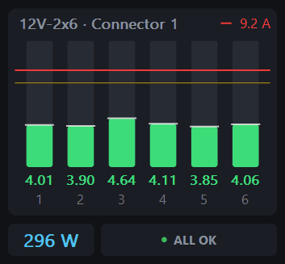
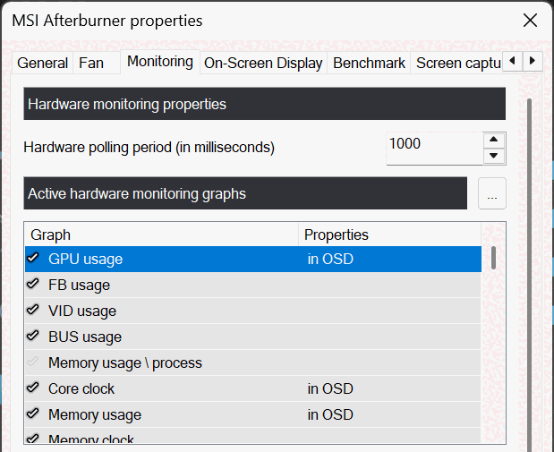
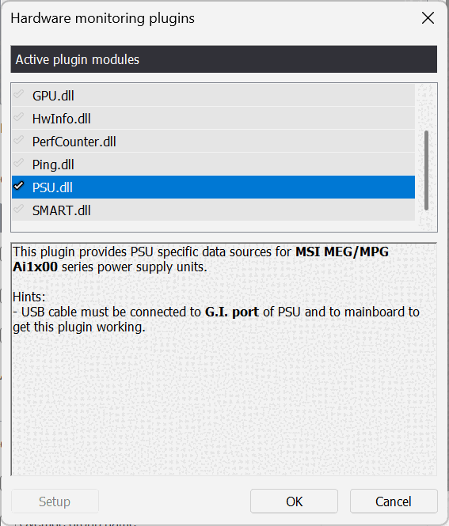
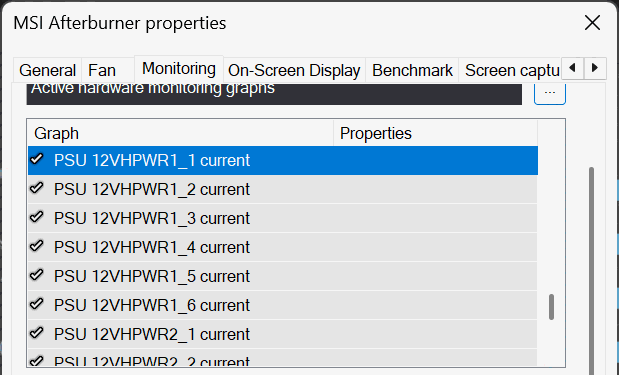
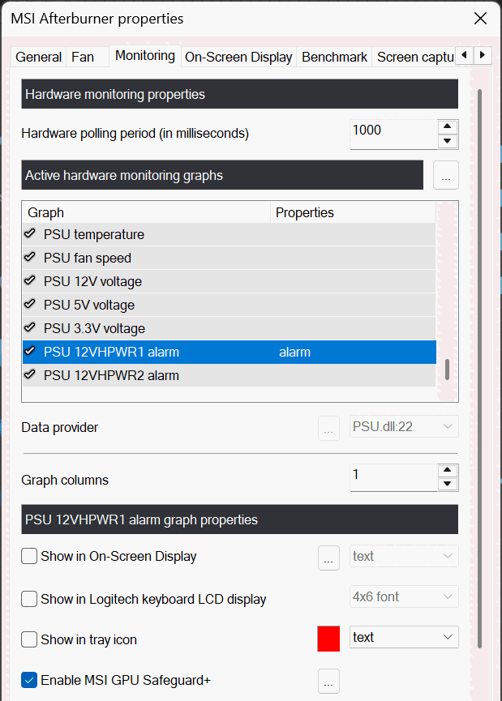
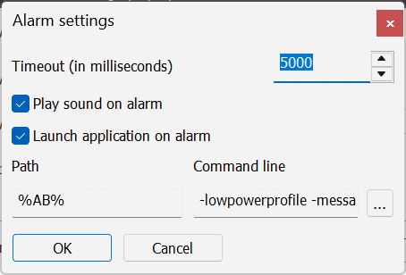
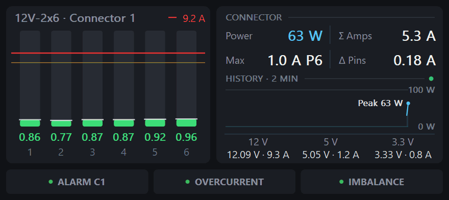

# PinGuard

A tiny monitor for the 12V-2x6 (12VHPWR) GPU power connector and the PSU values of the
**MSI MPG Ai1300TS PCIE5**. It shows the current on every pin, warns about overcurrent and
imbalance, and keeps an eye on power, efficiency, temperature and fan.

PinGuard is made to sit on a second monitor while you game, so it is built to cost you
**practically nothing**:

- **~14 MB RAM** (only **3 MB** of it private; the rest is shared Windows DLLs)
- **0.03 % CPU** on average (about 4 ms of work per second, 4 threads)
- **No GPU load at all**: no Direct3D, no overlay hooks, no animation loop. It only redraws when new data arrives
- A single **~340 KB** EXE, with no installer and no runtime


The same load cycle in the minimal view:



## Requirements

- Windows 11
- **MSI MPG Ai1300TS PCIE5** with its USB cable connected to the **G.I. port** of the PSU and to
  a USB header on the mainboard
- **[MSI Afterburner](https://www.msi.com/Landing/afterburner/graphics-cards)** **4.6.7 or newer**,
  running in the background

PinGuard does not talk to the power supply itself. Afterburner's bundled **PSU monitoring plugin**
reads the PSU over USB and publishes the values; PinGuard only reads them from Afterburner's
shared memory. So Afterburner has to run whenever you want to use PinGuard. RivaTuner Statistics
Server (the on-screen display) is not needed.

## Setting up MSI Afterburner

You only need to do this once.

MSI describes the plugin setup in their article
[MSI GPU Safeguard+ x MSI Afterburner](https://www.msi.com/blog/msi-gpu-safeguard-msi-afterburner-protect-your-gpu-by-reducing-power-during-abnormal-current).

1. Install MSI Afterburner 4.6.7 or newer, only from msi.com or Guru3D (MSI warns about fake
   download sites). The PSU plugin (`Plugins\Monitoring\PSU.dll`) is included.
2. Open Afterburner's **Settings** and go to the **Monitoring** tab.

   

3. Click the **…** button next to *Active hardware monitoring graphs*. In the window
   *Hardware monitoring plugins*, tick **PSU.dll** and confirm with OK.

   

4. Back in the list of *Active hardware monitoring graphs*, the new PSU entries now appear. Tick
   these (Afterburner only publishes ticked entries):

   

   - `PSU 12VHPWR1_1 current` … `PSU 12VHPWR1_6 current` (the six pins, **required**)
   - `PSU 12VHPWR2_1 current` … `PSU 12VHPWR2_6 current` (second connector, if your card has one)
   - `PSU 12VHPWR1 alarm`, `PSU 12VHPWR2 alarm`
   - `PSU 12V voltage`, `PSU 12V current`, `PSU 5V voltage`, `PSU 5V current`,
     `PSU 3.3V voltage`, `PSU 3.3V current`
   - `PSU power`, `PSU efficiency`, `PSU temperature`, `PSU fan speed`
   - optional: `Power` (GPU board power, for the *GPU power* metric)

   The order of the entries doesn't matter. Anything you leave unticked simply stays empty in
   PinGuard.
5. Optional: on the **General** tab, enable *Start with Windows* and *Start minimized*, so
   Afterburner is always running in the background.
6. Click **OK**. The values now update once per second (Afterburner's default
   *Hardware polling period* of 1000 ms).

### Recommended: let Afterburner react to alarms (GPU Safeguard+)

PinGuard shows and warns, but it doesn't change anything on your system. Afterburner can act
on its own: with **MSI GPU Safeguard+** enabled, it lowers the graphics card's power limit to
75 % as soon as the power supply reports abnormal current on the connector, and the PSU beeps.
Both work side by side.

1. In the **Monitoring** tab, select `PSU 12VHPWR1 alarm` (or `PSU 12VHPWR2 alarm` for the
   connector you actually use) and tick **Enable MSI GPU Safeguard+**.

   

2. Click the **…** button next to it. In *Alarm settings*, tick **Launch application on alarm**
   and load the **lowpowerprofile** that ships with Afterburner with the **…** button next to
   *Command line* (path `%AB%`, command line `-lowpowerprofile …`). *Play sound on alarm* adds a
   warning sound on the PC.

   

If an alarm fires, shut the PC down and check that the 12V-2x6 connector is fully seated and the
cable is undamaged.

If Afterburner isn't running or publishes no PSU values, PinGuard shows a notice and connects
automatically as soon as the data is there.

## Installation

Download `pinguard.exe` from the [latest release](https://github.com/mortan/PinGuard/releases/latest),
put it anywhere and start it. There is no installer. To run it at logon, right-click →
*Start with Windows*.

The EXE is not code-signed, so Windows SmartScreen may warn about an unknown publisher on the
first start (*More info* → *Run anyway*). Each release also lists the file's SHA-256 checksum
(`pinguard.exe.sha256`), which you can compare with `Get-FileHash pinguard.exe` in PowerShell.

Settings are stored in `%APPDATA%\PinGuard\pinguard.ini`.

## What you see

| Area | Content |
|---|---|
| Pin bars | The 6 pins of the active connector. Green below 8 A, yellow from 8 A, red from 9.2 A (the 12V-2x6 per-pin limit). A small line marks each pin's peak. An optional dashed line shows the pin average. Connector 2 only appears once it carries current. |
| Connector | Power, total current, highest pin, imbalance. Optional: load relative to 600 W and GPU board power. |
| PSU | DC output power, efficiency, temperature, fan speed. Can be replaced by a **2-minute history chart** of connector power. |
| Rails | 12 V / 5 V / 3.3 V voltage and current. |
| Connection dot | Next to the PSU heading. Green = data is coming in, red = no data, orange ring = the connection was lost in the meantime. |
| Status line | **ALARM C1/C2** (alarm reported by the PSU itself), **OVERCURRENT** (a pin above the red limit), **IMBALANCE**. Red = active, orange outline = was active (latched until you click it). |

With the history chart enabled, the PSU group shows connector power over the last two minutes,
with the peak marked:



Hover over almost anything for a tooltip with exact values and limits. While an alarm is active or
latched, its tooltip shows when it fired, how long it lasted and the worst value, e.g.
"Triggered 14:32, pin 3: 9.6 A, duration 4 s".

Note: PSU power is the DC output power. The draw from the wall is roughly PSU power ÷ efficiency.

## Controls

- **Drag** anywhere to move the window. **Resize** from the edges; the aspect ratio is kept.
- **Minimal view / minimize / close:** buttons appear at the top right while the mouse is over the
  window.
- **M key:** switch between the full and the minimal view (while the window is active).
- **Click the status line or the connection dot:** clear latched alarms.
- **Double-click:** reset the peaks.
- **Right-click:** menu with reset, *Limits and alarms …*, *Minimal view*, *Always on top*,
  *Minimize to notification area*, *Start with Windows*, *Language*, *Event log* and *Exit*.
- Only one instance runs. Starting it again brings the existing window to the front.

### Minimal view

The view button at the top right, the **M** key or right-click → *Minimal view* shrink the window
to the pin bars. Below them are the connector power
and a single status field: **ALL OK** with a green dot, red with the alarm name while an alarm is
active (further alarms as "+1", "+2" …), or an orange outline while an alarm is latched. The link
to Afterburner is part of this field, so a lost connection shows up there. Hover over the field to
see every alarm's state, and click it to clear latched alarms. The same button, key or menu item
returns to the full view. The window keeps its height, and the choice is remembered.

### Tray

With *Minimize to notification area* enabled, minimizing hides the window from the taskbar. A round icon in
the notification area shows the state: **green** = OK, **yellow** = warning level or a latched
alarm, **red** = alarm active, **grey** = no data. Its tooltip shows connector power, the highest
pin and active alarms. Left-click brings the window back, right-click opens the menu.

### Limits and alarms

Right-click → *Limits and alarms …* (changes apply immediately):

| Setting | Default |
|---|---|
| Pin yellow from | 8 A |
| Pin red / overcurrent from | 9.2 A |
| Bar full scale | 12 A |
| Imbalance measured as | percent |
| Imbalance limit (largest deviation of a pin from the average), percent mode | 30 % |
| Percent mode only above a connector current of | 20 A |
| Imbalance limit (highest − lowest pin), amps mode | 3 A |
| Rated power per connector (for the load figure) | 600 W |

**Percent or amps?** *Percent* (the default) scales with the load: a failed pin is 100 %
deviation, whether the card draws 200 W or 600 W. *Amps* compares the strongest with the weakest
pin. It is meaningful under high load but can miss even a failed pin at low load. Below the minimum current it isn't evaluated, because measurement noise alone
causes large percentages there. Either way the imbalance figure turns yellow at half the limit and
red at the limit.

For every alarm (connector 1, connector 2, overcurrent, imbalance, no data) you can choose:

- **Active:** evaluate and show it
- **Latch:** keep it marked in orange until you click the status line
- **Sound:** play a warning sound when it fires
- **Show:** bring the window to the front (without stealing focus) and flash it in the taskbar

By default all alarms are active and latching. The alarms from the PSU (connector 1 and 2) and
overcurrent also play a sound, since you rarely look at a second monitor while gaming. Imbalance
and no data stay silent. *Show* is off for all of them.

These defaults only apply when there is no `pinguard.ini` yet. PinGuard writes the file with all
settings, so later versions with different defaults don't change an existing setup.

The same dialog lets you show or hide each metric, the rails, the yellow warning line, the average
line and the history chart.

### Event log

PinGuard appends a line to `%APPDATA%\PinGuard\events.csv` for every new alarm: time, alarm type,
all 12 pin currents, 12 V voltage and connector power (semicolon-separated, decimal point). At
1 MB the file is renamed to `events.old.csv` and a new one is started. Turn it off or open the
folder via right-click → *Event log*.

### Language

English and German. By default PinGuard follows the Windows display language. You can change it
via right-click → *Language*; it applies immediately.

## Command line

```
pinguard.exe [--topmost] [--mock]
```

- `--topmost` starts the window always on top.
- `--mock` shows simulated data (including overcurrent, imbalance and a short dropout) so you can
  try PinGuard without the hardware.

## Building from source

```bash
cargo build --release
```

Requires Rust with the MSVC toolchain. The result is `target\release\pinguard.exe`.

## License

MIT, see [LICENSE](LICENSE).
