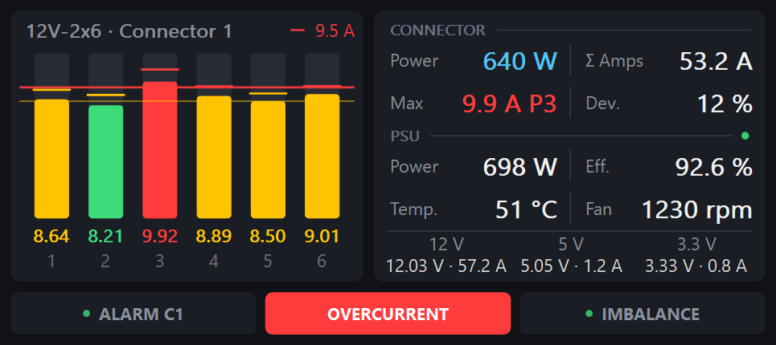

# GpuMon

Kompakter Monitor für den 12V-2x6-Stecker (12VHPWR) und die Netzteilwerte des
**MSI MPG Ai1300TS PCIE5**. Er zeigt Ströme pro Pin, Fehlerstatus und
Kennzahlen, ähnlich wie WireView, nur dichter gepackt. Gedacht für den zweiten
Monitor beim Spielen, daher auf minimalen Verbrauch ausgelegt.



Mock-Modus mit Schieflast, Alarm und gelatchtem Überstrom: [docs/screenshot-mock-faults.png](docs/screenshot-mock-faults.png)

## Anzeige

| Bereich | Inhalt |
|---|---|
| Balken links | 6 Pins des aktiven Steckers. Ampel (Standard, einstellbar): grün < 8 A, gelb 8–9,2 A, rot ≥ 9,2 A. Vollausschlag 12 A, rote Linie an der Rot-Grenze, gelbe Linie an der Gelb-Grenze, Strich = Peak seit Start/Reset. Stecker 2 erscheint nur, wenn er Strom führt. |
| Kennzahlen rechts | Zwei Gruppen. **Stecker:** Leistung (Σ Pins × gemessene 12 V), Σ Strom, Max-Pin, Schieflast (Δ Pins in A oder Abw. in %, je nach Messart). **Netzteil:** DC-Leistung, Effizienz, Temperatur, Lüfter. Zusätzlich einblendbar: Auslastung (bezogen auf die Nennleistung je Stecker) und GPU-Board-Power (Afterburner `Power`). |
| Rails | 12 V / 5 V / 3,3 V: Spannung und Strom (ausblendbar) |
| Verbindung | Kleiner Punkt am Ende der Überschrift „NETZTEIL“: grün = Daten kommen, rot mit „keine Daten“ = Verbindung zur Datenquelle weg, orange Ring = war unterbrochen (Klick setzt zurück), blass = Alarm abgeschaltet. |
| Statuszeile | ALARM S1/S2 (Alarm-Flag, das das Netzteil selbst je Stecker meldet), ÜBERSTROM (Pin ≥ Rot-Grenze), SCHIEFLAST (Grenze in A oder %, siehe unten; Standard 3 A). **Rot** = aktiv, **orange umrandet** = war aktiv (gelatcht), blass = abgeschaltet. ALARM S2 erscheint erst, wenn Stecker 2 seit dem Start Strom geführt hat oder sein Alarm auslöst. |

Bedienung:
- Fenster an beliebiger Stelle ziehen. Größe an den Rändern ändern, das Seitenverhältnis bleibt dabei erhalten.
- **Klick auf die Statuszeile oder den Verbindungspunkt:** gelatchte Fehler zurücksetzen
- **Doppelklick:** Peaks zurücksetzen
- **Rechtsklick:** Menü mit Peaks/Fehler zurücksetzen, *Grenzen und Alarme …*, *Immer im Vordergrund*, *Sprache*, Beenden
- Position, Größe, *Immer im Vordergrund*, Sprache, Grenzwerte und Alarme werden in `%APPDATA%\GpuMon\gpumon.ini` gespeichert.
- Es läuft nur eine Instanz. Ein zweiter Start holt das vorhandene Fenster nach vorn.

### Sprache

Die Oberfläche gibt es auf Deutsch und Englisch. Standard ist *Automatisch*: Deutsch, wenn die
Windows-Anzeigesprache Deutsch ist (alle Regionen), sonst Englisch. Über *Rechtsklick → Sprache*
lässt sich *Automatisch (Windows)*, *Deutsch* oder *English* fest wählen; das wirkt sofort, ohne
Neustart. INI-Schlüssel `lang` = `auto` / `de` / `en` (fehlt er, gilt `auto`). Zahlen erscheinen
im Format der Sprache (Deutsch `9,2 A`, Englisch `9.2 A`). Im Einstellungsdialog werden Komma und
Punkt immer akzeptiert. Englische Kurzformen: Statusfelder ALARM C1/C2, OVERCURRENT, IMBALANCE;
Kennzahlen u. a. „Σ Amps“, „Dev.“, „Eff.“.

### Grenzen und Alarme

Über *Rechtsklick → Grenzen und Alarme …* (wirkt sofort, Komma oder Punkt als Dezimalzeichen):

| Grenzwert | Standard | INI-Schlüssel |
|---|---|---|
| Pin gelb ab | 8 A | `pin_warn` |
| Pin rot / Überstrom ab | 9,2 A | `pin_limit` |
| Balken-Vollausschlag | 12 A | `full_scale` |
| Schieflast messen als | Ampere | `imbalance_mode` (`amps` / `percent`) |
| Schieflast (max − min) ab, Modus Ampere | 3 A | `imbalance` |
| Schieflast (größte Abweichung eines Pins vom Mittelwert) ab, Modus Prozent | 30 % | `imbalance_pct` |
| … Prozent-Modus erst ab Steckerstrom (Σ 6 Pins) | 20 A | `imbalance_min_load` |
| Nennleistung je Stecker (Bezug für die Auslastung) | 600 W | `rated_w` |

**Schieflast-Messart:** *Ampere* vergleicht den stärksten mit dem schwächsten Pin (wie `CurrentDif`
im MSI-Plugin). MSI verwendet dort 5,5 A. Bei ~8,3 A pro Pin unter Volllast und 9,2 A Pin-Limit
schlägt das erst sehr spät an, daher ist der Standard hier 3 A (gelb ab 1,5 A). Das ist bei hoher Last aussagekräftig, übersieht aber bei wenig Last sogar einen
ausgefallenen Pin. *Prozent* bewertet die Abweichung vom Mittelwert und skaliert so mit der Last. Unterhalb der
Mindestlast wird nicht bewertet, weil dort schon Messrauschen große Prozentwerte ergibt (ähnlich
WireView Pro II: „Imbalance Limit (%)“ plus „Imbalance Current Limit (A)“). Ein ausgefallener Pin
entspricht 100 % Abweichung. Die Kennzahl links heißt je nach Modus „Δ Pins“ (A) oder „Abw.“ (%).
Sie wird ab der halben Grenze gelb und ab der Grenze rot.

**Anzeige:** Rechts im Dialog lässt sich jede Kennzahl ein- und ausblenden (INI: `show_<name>` = 0/1 mit
`conn_w`, `sum_a`, `max_pin`, `imbalance`, `load`, `gpu_w`, `psu_w`, `eff`, `temp`, `fan`, `rails`).
Standardmäßig aus sind Auslastung und GPU-Leistung.

Je Alarm (`alarm1`, `alarm2`, `overcurrent`, `imbalance`, `nodata`) gibt es vier Schalter:
**Aktiv** (`<alarm>_on`: auswerten und anzeigen), **Halten** (`_latch`: bleibt orange markiert bis zum Klick auf die Statuszeile),
**Ton** (`_sound`: Warnton beim Auftreten) und **Zeigen** (`_show`: Fenster wiederherstellen, ohne Fokuswechsel nach vorne holen und in der Taskleiste blinken).
Standard: alle aktiv und haltend, ohne Ton und ohne Zeigen. Ungültige Grenzwerte in der INI werden ignoriert, dann gelten die Standardwerte.

Kommandozeile: `gpumon.exe [--mock] [--topmost] [--mahm-name NAME]`
- `--mock` erzeugt Fake-Daten (Rampe bis Rot, Schieflast, Alarm, 5 s „offline“) zum Testen ohne Hardware.
- `--mahm-name` liest eine andere Shared-Memory-Section, nur für Tests.

## Voraussetzungen

MSI Afterburner (getestet: 4.6.7) mit dem mitgelieferten PSU-Plugin
(`Plugins\Monitoring\PSU.dll`), das das Netzteil per USB ausliest. GpuMon liest
Afterburners Shared Memory `MAHMSharedMemory` nur lesend aus und sucht die
Quellen per Name (`PSU 12VHPWR1_1 current` …). Die Reihenfolge, in der die
Quellen in Afterburner aktiviert sind, spielt deshalb keine Rolle.

Läuft Afterburner nicht, zeigt GpuMon einen Hinweis. Alle 2 s wird erneut
versucht zu verbinden. Wenn Afterburner sich beendet (Signatur `0xDEAD`) oder
der Zeitstempel 10 s lang stehen bleibt (Afterburner abgestürzt oder hängt),
gibt GpuMon das Mapping frei und verbindet sich neu.

Hinweis zu den Werten: `PSU power` ist die **DC-Leistung der 12-V-Schiene**
(12V current × 12V voltage), nicht die Aufnahme an der Steckdose. Die
AC-Aufnahme beträgt ungefähr PSU DC ÷ Effizienz.

## Bauen

```bash
cargo build --release
```

Das Ergebnis ist `target\release\gpumon.exe` (~190 KB, statisch gelinkt, ohne Runtime und ohne Konsolenfenster).
Tests: `cargo test` (Modell, MAHM-Parsing gegen Byte-Puffer, Einstellungen, Tooltips und Textbreiten je Sprache).

## Technik und Entscheidungen

- **Rust + `windows`-Crate, reines Win32-Fenster ohne UI-Framework.** Das Fenster ist
  rahmenlos (`WM_NCCALCSIZE`), mit Windows-11-Ecken, Per-Monitor-DPI v2 und skalierendem
  Layout (Basisraster 440 × 196 DIPs).
- **Gezeichnet wird mit GDI/GDI+, nicht mit Direct2D.** Ursprünglich war Direct2D
  vorgesehen (siehe HANDOVER). Gemessen hat sich gezeigt: Direct2D lädt auch im
  Software-Modus D3D11/WARP. Daraufhin hängt sich **RTSS** (samt NVAPI) in den
  Prozess ein, wie in jede D3D-Anwendung. Ergebnis: 43 MB Working Set, 74 MB
  privat, 21 Threads. Mit GDI+ (geglättete Formen) und GDI-ClearType-Text in
  einen Backbuffer bleibt der Prozess für RTSS uninteressant, genauso wie
  Afterburner selbst.
- **Kein Dauer-Rendering.** Ein Timer liest alle 250 ms das Shared Memory (ein
  paar Dutzend Bytes). Neu gezeichnet wird nur, wenn sich die Werte ändern. Bei
  Afterburners Standardperiode ist das 1× pro Sekunde, dazu kommen
  `WM_PAINT`/Resize. Minimiert wird nicht gezeichnet, und Backbuffer und
  Schriften werden freigegeben.
- **Die Datenquelle liegt hinter dem Trait `PsuSource`** (`src/source/`). Ein
  späterer direkter HID-Zugriff (`VID_0DB0&PID_AA6F`, Mutex
  `Global\MSI_PSU_Mutex`) kann Afterburner ersetzen, ohne dass sich an der UI
  etwas ändert.

```
src/
  main.rs          Fenster, Message-Loop, Timer, DPI, Hit-Test, Menü
  i18n.rs          Texte Deutsch/Englisch, Zahlenformat, Sprachwahl
  settings.rs      Position/Größe/Topmost, Sprache, Grenzwerte, Alarme (INI)
  settings_dlg.rs  Einstellungsdialog (Win32-Dialog aus Speichervorlage)
  model.rs         PsuSnapshot, Kennzahlen, Peaks, Fehler, Grenzwert-/Alarm-Konfiguration
  render.rs        Layout + Zeichnen (GDI+/GDI), Farben
  source/mod.rs    trait PsuSource
  source/mahm.rs   Afterburner-Shared-Memory (Parsing + Verbindung)
  source/mock.rs   Fake-Daten
rtss/              RTSS-Overlays (*.ovl) und ihre Generatoren (nicht Teil der App)
```

## Gemessener Verbrauch

Release-Build, Fenster 1064 × 474 px auf dem zweiten Monitor (5120 × 1440),
Afterburner liefert Live-Daten, nebenher läuft ein Spiel mit ~500 W GPU-Last.
Messzeitraum 120 s, gemessen per `Get-Process` bzw. Performance-Counter, 16 logische CPUs:

| Größe | Wert |
|---|---|
| Working Set | **14,2–14,3 MB** (davon privat nur **3,0 MB**; der Rest sind gemeinsam genutzte System-DLLs) |
| CPU | 531 ms in 120 s = 0,44 % eines Kerns = **0,03 % gesamt** (Redraw ≈ 4 ms/s; minimiert ≈ 0,5 ms/s) |
| GPU | **0**. Der Prozess hat keine GPU-Engine-Instanz, D3D wird nicht geladen. |
| Threads | 4 |
| Zum Vergleich: erste Version mit Direct2D (Software) | 43 MB WS, 74 MB privat, 21 Threads |

## Abgleich

Live gegen `MAHMSharedMemory` geprüft (gleiche Quelle wie das RTSS-Overlay):
Pins 6,25/6,12/6,06/6,12/6,06/6,25 A, PSU 492 W, 93,9 %, 61 °C,
12,08 V/40,8 A. Alle Werte stimmen exakt überein.

Wiederverbindung mit simulierter Section getestet: Start ohne Quelle → Hinweis,
Quelle erscheint → Daten, `0xDEAD` → Hinweis + gelatchter VERBINDUNG-Fehler,
Quelle wieder da → Daten, eingefrorener Zeitstempel → nach 10 s Hinweis.
